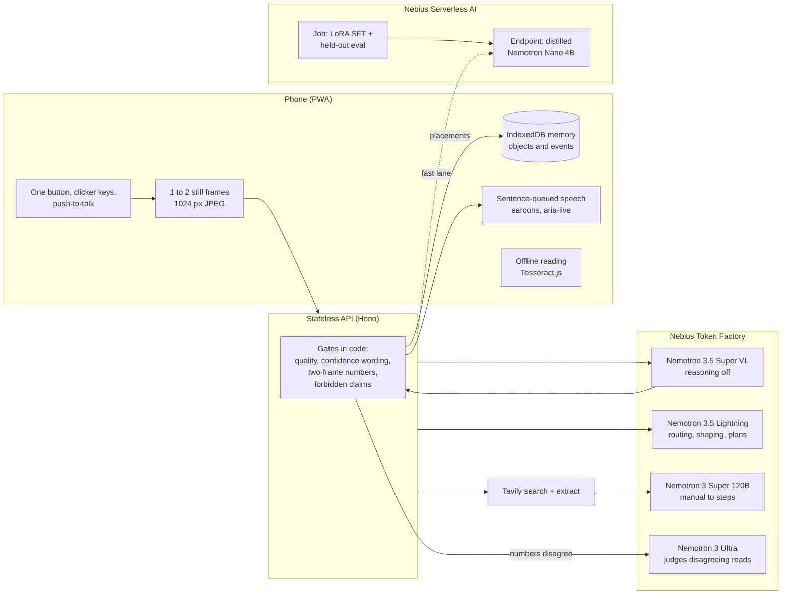

# Aloud

**One press, and it tells you what's in front of you, and when it isn't sure.**

Aloud is a visual assistant for blind and low-vision people, with a simple mode for people with cognitive disabilities. Wear a phone on your chest or hold it, and press one button. Aloud can:

- read text exactly as written, and describe what's in front of you, hazards first, with clock positions;
- name the object you're holding;
- walk you through an appliance one step at a time, checking each step with the camera;
- remember where you put your things, on your phone only.

When the picture is too dark, blurry or cut off, Aloud doesn't guess. It tells you how to move the camera. It speaks a price only when two frames agree. It never says a road is safe to cross, never identifies people, and never gives dosing advice.

> Aloud is not a medical device and not a mobility aid. Use it alongside your cane, guide dog, or a trusted person.

Built for the Nebius x NVIDIA Global AI Hackathon, **Personal AI** track.

## Try it

- **Demo:** _deployment link coming_. Open it on a phone over HTTPS. On a laptop, choose **Samples**: every skill works on the bundled sample photos, no camera needed.
- **Controls:** tap anywhere to hear what's in front of you. Double-tap repeats. Hold to talk.
- **Buttons:** Read, What is this, Find, Talk, Repeat and Stop. You can also type a request instead of speaking.
- **Bluetooth clicker or keyboard:**

  | Key | Action |
  |---|---|
  | Space, Enter, Page Down | Main action |
  | Page Up | Repeat |
  | R | Read |
  | W | What is this |
  | F | Find |
  | T or M | Talk |
  | L | Look harder |
  | C | Cancel |
  | S or Esc | Stop |
  | H | Help |

- **Screen readers:** Settings has an **Answer mode**. "Use my screen reader" silences Aloud's voice and sends answers to an `aria-live` region, so VoiceOver or TalkBack never speaks over Aloud.

## What it does

| Skill | Say or press | What happens |
|---|---|---|
| Describe | Tap, "what's in front of me" | A few short sentences: hazards first, then up to four things, with clock positions and rough distance |
| Read | R, "read this" | Verbatim text in reading order. Unsure words are hedged. Numbers are spoken only when two frames agree. |
| What is this | W, "what is this" | The main object and its label |
| Remember | "I'm putting my keys on the hall shelf" | Checks with the camera that it really is your keys, then stores the placement on the phone |
| Find | F, "where are my keys" | Answers from local memory, offline too, with its status: confirmed, last confirmed, unknown, or "which one?" |
| Learn an object | "remember this as my house keys" | Three views; Aloud describes what it sees and asks you to confirm |
| Appliance helper | "help me use this microwave" | Reads the model number, finds the manual with Tavily, then gives steps one at a time and checks each with the camera |
| Simple mode | Settings | Sentences of at most 15 words, one step per turn, encouragement, "Did that work?" |
| Look harder | L, "look harder" | Re-reads the last picture with the vision model's reasoning turned on |

## How it works



**The model never writes what Aloud says about an image.** Super-VL returns structured JSON: image quality flags, `can_answer`, and items with kind, content, confidence, clock position and distance. Code then decides what is safe to say:

- **Quality gate:** if the model can't answer, or a quality flag is set and nothing is confident, Aloud speaks only fixed camera guidance ("Too dark. Try a light, or move toward the window.").
- **Confidence wording:** at 0.8 or above, an item is said plainly. From 0.5 to 0.8, it's "I think it says …, but I'm not sure." Below 0.5, it's dropped and counted ("There's more text I can't read.").
- **Two-frame numbers:**
  - Read takes two frames 400 ms apart. A number is spoken as certain only if both frames give the same normalised value.
  - If they disagree, Nemotron 3 Ultra adjudicates between the two structured reads. It never sees the images.
  - Code then rejects any reading that neither frame produced, and otherwise abstains: "I see a number but can't confirm it. Move closer."
- **Forbidden claims:** these are checked in code on every request and every output.
  - People are always rendered from a template ("A person, a few steps away, at 1 o'clock").
  - Traffic-safety judgements, including a signal's colour, are replaced with "I can't judge traffic safety…".
  - Medicine labels are read word for word, with "Please confirm with a pharmacist", and never summarised.
  - Unsafe requests are refused before any model is called.
- **Memory:**
  - Placements become trusted only when the camera confirms the object (identity confidence ≥ 0.7). Weak sightings are stored but never promoted.
  - Answers come from fixed templates that keep their status words: "I last confirmed your keys on the hall shelf today at 10:42, but they were picked up afterward. I haven't confirmed them anywhere since."

## Models, and why each one

All four run on **Nebius Token Factory** (serverless, OpenAI-compatible). Each has one job.

| Model (exact id) | Job | Why this model |
|---|---|---|
| `nvidia/Nemotron-3.5-Super-VL` | All perception: describe, read, identify, learn an object, match it later, read model numbers, check appliance steps | Image input with strict JSON output. Run with `reasoning_effort: "none"` on every press: thinking is on by default and costs latency. "Look harder" is the one deliberate slow path, with reasoning on. |
| `nvidia/Nemotron-3_5-Lightning` | Intent routing (tool calling with flat, typed arguments), easy-language rewriting, simple-mode plans | Cheap and fast for the everyday text calls ($0.06/$0.24 per 1M tokens) |
| `nvidia/nemotron-3-super-120b-a12b` | Turns a Tavily manual excerpt into 3 to 6 steps, each with a camera check | Stronger reading of long, messy manual text |
| `nvidia/Nemotron-3-Ultra-550b-a55b` | Settles disagreements between two vision reads; teacher for distillation; judge in evaluation | Serious reasoning, used sparingly: it judges between reads instead of "seeing" |
| `nvidia/NVIDIA-Nemotron-3-Nano-4B-BF16` + LoRA | Optional fast lane for routing, shaping and plans | Distilled on Nebius Serverless AI (below). Small enough to run offline later. |

### Where Token Factory accelerated the work

- **One API, four Nemotron models.** Changing a model's role is changing an id, with no GPUs to host for the interactive path.
- **Structured outputs and tool calling** on the same endpoint. The client asks for strict `json_schema`, and automatically falls back to `json_object`, then to prompt-only JSON, if a model rejects it, with one corrective retry.
- **`reasoning_effort` control** keeps vision fast for blind users and still gives a slow, careful path on request.
- **Usage in every response** powers the per-answer metrics in the app (latency, tokens, cost), the daily budget cap, and the evaluation's cost per hour.
- **Nemotron 3 Ultra as teacher and judge** made it cheap to generate and validate distillation data and to grade descriptions.

### Nebius Serverless AI: beyond inference

`distill/` distils the everyday text work into **Nemotron 3 Nano 4B**:

- **Teacher data:** Nemotron 3 Ultra on Token Factory writes the examples, and code keeps only those that pass Aloud's own checks.
- **Job:** a **Serverless AI Job** (1× L40S) runs the LoRA SFT plus a held-out evaluation against the untouched base model. Artifacts go to Object Storage.
- **Endpoint:** a **Serverless AI Endpoint** (vLLM, token auth) serves the result.
- **Fallback:** the API uses the endpoint only when it's up, and falls back to Lightning otherwise. The endpoint is stopped when not in use.
- **Details:** recipe, commands and fallbacks are in [distill/README.md](distill/README.md).

### Tavily

The appliance helper reads the model number from the label and requires both frames to agree. It then calls Tavily `search` for the manual and Tavily `extract` for the task-relevant chunks of the best pages. Web text is treated as untrusted data: steps containing links or unsafe claims are dropped.

### Not used, and why

NemoClaw, OpenShell and Hermes Agent sandbox general-purpose agents. Aloud is a camera PWA with a fixed set of skills, so we didn't bolt one on.

## Evaluation

`npm run eval` runs the harness in [eval/](eval/README.md) and writes [docs/eval.md](docs/eval.md):
- Every rate is printed with its numerator and denominator.
- Sets smaller than 30 are flagged.
- Results are reported on a dev split and a held-out split.

Measured so far:

| What | Result |
|---|---|
| Memory scenarios (place, pick up, move silently, camera check, user-stated move, ambiguous names) | 14/14 correct status and wording (small set) |
| Routing, offline rules lane, dev split (rules were tuned on this) | 49/49 |
| Routing, offline rules lane, held-out split | 26/33 (78.8%). The paraphrases are what the Lightning lane is for. |

Vision metrics are pending a run with a Token Factory key and real photos, and will be added here: OCR error rate, invented words, key-fact recall, unsupported sentences, correct abstention on bad shots, forbidden-claim violations, numbers not on the page, latency and cost per hour. The bundled sample photos are rendered scenes. They prove the pipeline end to end; they are not a reliability claim.

## Privacy and safety

- **Your memory stays on your phone** (IndexedDB). You can export it or delete it all from **My things**.
- **The API is stateless.** It stores no images or audio. Logs hold only timings, token cost and a short hash of the frame.
- **When pictures leave the phone.** They go to Nemotron models on Nebius Token Factory only when you press. Nebius advertises zero-retention inference.
- **Learning and checking objects.** Learning an object sends one photo to get a description. Checking where it is later sends its small saved thumbnails for that one comparison. The thumbnails themselves stay on the phone.
- **Voice input** uses the browser's speech recognition, which some browsers process in their maker's cloud. Typing always works instead.
- **The camera is released** whenever the app isn't visible.
- **Safety rules are enforced in code**, not just in prompts. See [How it works](#how-it-works).

## Setup

Requirements: Node.js 20 or later, plus a [Nebius Token Factory](https://tokenfactory.nebius.com) API key. A [Tavily](https://tavily.com) key is needed only for the appliance helper.

```bash
git clone https://github.com/big14way/aloud.git
cd aloud
npm install
cp .env.example .env        # add NEBIUS_API_KEY (and TAVILY_API_KEY)
npm run dev:api             # API on http://localhost:8787
npm run dev                 # app on http://localhost:5173 (proxies /api)
```

Phones only allow camera access over HTTPS, so test on a phone through a deployment or an HTTPS tunnel.

| Command | What it does |
|---|---|
| `npm test` | All unit tests (gates, safety, memory, routing, API, evaluation helpers) |
| `npm run typecheck` | Type-check the client and the server |
| `npm run eval` | Evaluation, see above |
| `npm run record-samples` | Records saved answers for the sample photos from a live run. Used only when the live API can't answer, and always labelled as saved. |
| `npm run samples` | Re-renders the sample photos (needs Playwright) |

**Deploy:** `vercel.json` serves the PWA as static files and the API as one Hono function at `/api`. Set `NEBIUS_API_KEY` and `TAVILY_API_KEY` in the project's environment variables. `DAILY_BUDGET_USD` and `SESSION_LIMIT_PER_HOUR` cap demo spending; they are in-memory per instance, so treat them as best-effort.

## Limits

- **English only.**
- **Not yet tested with blind or low-vision users.** Their feedback will be added here only with their consent.
- **Describe and What-is need a connection.** Offline, Aloud can still read text (on-device OCR, after a one-time download in Settings) and answer "where are my things".
- **Vision models can misread.** Aloud hedges, abstains and asks for a better shot, but it can still be wrong. Small or angled text is the hardest case.
- **The distilled fast lane is optional,** and its endpoint is usually stopped. Lightning handles those calls by default.
- **iOS Safari can't vibrate,** so earcons stand in for haptics.

## Licence

[MIT](LICENSE)
